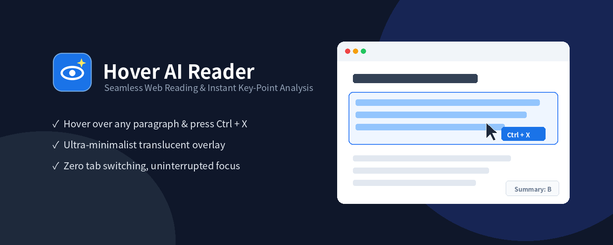
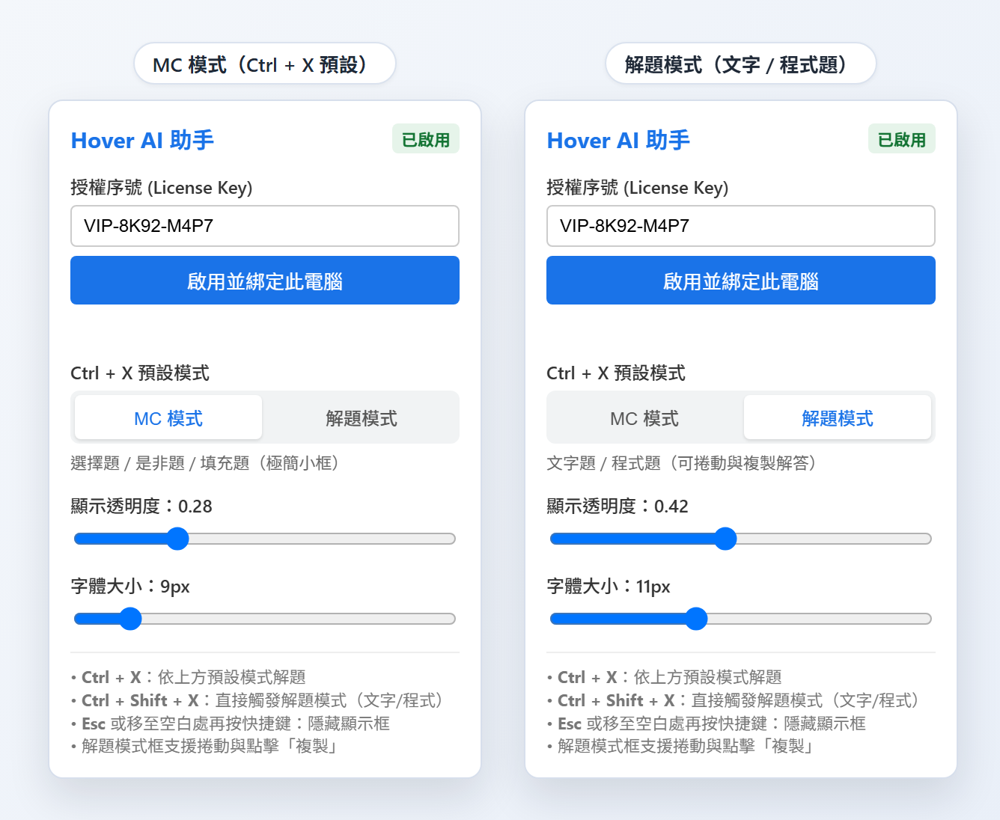
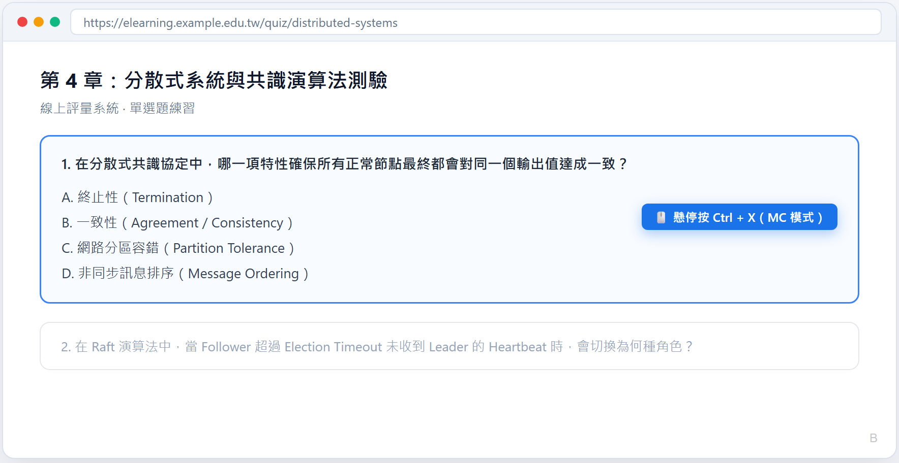
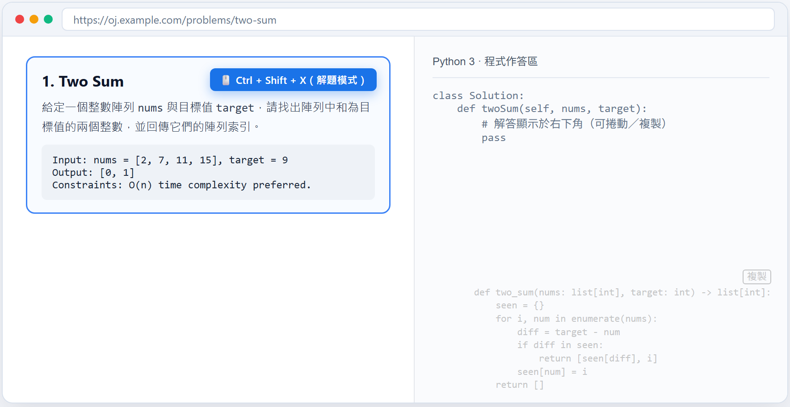
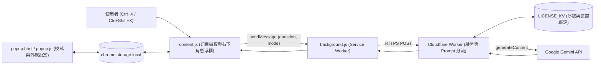

<div align="center">
  
  <h1>Hover AI Reader</h1>
  <p><strong>網頁懸停即時重點解析與雙模式解題助手</strong></p>
  <p>
    
    
    
    
  </p>
  <p>
    <a href="https://chromewebstore.google.com/detail/bagehkpnffokdkeijgopaboedbolijmj?utm_source=item-share-cb">
      
    </a>
  </p>
  <p><sub><strong>Copyright (c) 2026 Simon C.-Y. Wong. All rights reserved.</strong></sub></p>
</div>

<p align="center">
  
</p>

滑鼠懸停即可即時解析網頁題目與段落重點，免切換分頁、不中斷閱讀動線，支援自訂極簡透明浮動顯示。  
**v1.1.0** 起完整保留原有的 **MC 模式（選擇／是非／填充）**，並新增專為 **文字題與程式題** 打造的 **解題模式**，搭配雙快捷鍵即時觸發、可捲動等寬程式碼顯示與一鍵複製功能。

---

## 目錄

- [核心特色](#-核心特色)
- [介面與實機截圖](#-介面與實機截圖)
- [快捷鍵與操作方式](#-快捷鍵與操作方式)
- [雙模式規格比較](#-雙模式規格比較)
- [系統架構](#-系統架構)
- [安裝與打包指南](#-安裝與打包指南)
- [專案結構](#-專案結構)
- [版權聲明](#-版權聲明)

---

## ✨ 核心特色

* **雙模式智能分流**：
  * **MC 模式**：專為選擇題、是非題、填充題設計，僅在螢幕右下角顯示極簡答案代號，不佔版面、不攔截滑鼠操作。
  * **解題模式**：專為簡答題、計算題與程式設計題打造，支援完整程式碼與條列結論輸出、等寬字體排版、滾輪捲動與右上角「複製」按鈕。
* **雙快捷鍵零切換延遲**：無須頻繁打開 Popup，在混合題型頁面中可隨時用 `Ctrl + X` 與 `Ctrl + Shift + X` 分別觸發對應模式。
* **極簡隱蔽浮動層（Stealth Overlay）**：支援即時調整文字透明度（`0.10` – `0.80`）與字體大小（`8px` – `16px`），所有開啟的分頁皆同步套用。
* **智慧題目擷取**：
  * 支援「滑鼠懸停自動識別題目容器」與「手動反白選取 / `<textarea>` 選取優先送出」。
  * 解題模式會自動辨識題目區塊（如 `article`、`role="listitem"`、常見題卡與題幹容器），並避免誤抓導覽列或旁邊的 `.monaco-editor` / `.CodeMirror` 編輯器 UI。
* **安全架構與授權控管**：所有 AI 請求統一由 `content.js` 經 `background.js` 轉發至 Cloudflare Worker，避免網頁 CSP 阻擋並保護 `GEMINI_API_KEY`，同時支援序號綁定與裝置驗證。

---

## 📸 介面與實機截圖

### 1. 擴充功能 Popup 設定面板（v1.1.0）

支援授權序號啟用與單機綁定、**Ctrl + X 預設模式切換**（`MC 模式` / `解題模式`），以及透明度與字體大小即時預覽調整：

<p align="center">
  
</p>

### 2. MC 模式（`Ctrl + X`）— 選擇／是非／填充題

滑鼠停留在題目區塊按下 `Ctrl + X`，系統自動辨識題幹與選項，於頁面右下角以低干擾透明小框顯示最精簡答案，且完全不阻擋滑鼠點擊與滾動：

<p align="center">
  
</p>

### 3. 解題模式（`Ctrl + Shift + X`）— 文字題與程式題

針對程式題或問答題按下 `Ctrl + Shift + X`（或在 Popup 將預設模式切換為「解題模式」後按 `Ctrl + X`），右下角會展開為支援等寬字體、滾輪捲動與一鍵「複製」的透明解答框：

<p align="center">
  
</p>

---

## ⌨️ 快捷鍵與操作方式

| 操作 / 快捷鍵 | 行為說明 |
| :--- | :--- |
| **`Ctrl + X`** | 依 Popup 設定的「預設模式」解析（預設為 **MC 模式**；切換為解題模式後則執行解題模式） |
| **`Ctrl + Shift + X`** | 不論預設設定為何，直接以 **解題模式（文字／程式題）** 進行解析 |
| **`Esc`** | 立即隱藏右下角懸浮框，並取消尚未回傳的請求 |
| **空白處再按快捷鍵** | 將滑鼠移至頁面空白背景再按 `Ctrl + X` 或 `Ctrl + Shift + X`，即可隱藏懸浮框 |
| **反白文字 + 快捷鍵** | 若頁面有手動反白選取文字（含輸入框／`<textarea>` 選取），會優先送出選取內容並自動清除反白 |
| **點擊右上角「複製」** | 僅在解題模式顯示；一鍵複製純解答文字或程式碼至剪貼簿 |

---

## ⚖️ 雙模式規格比較

| 項目 | MC 模式（`mc`） | 解題模式（`solve`） |
| :--- | :--- | :--- |
| **適用題型** | 單選題、多選題、是非題、填充題 | 程式設計題、演算法、除錯、簡答／計算題 |
| **預設快捷鍵** | `Ctrl + X` | `Ctrl + Shift + X`（或於 Popup 設為預設） |
| **懸停擷取上限** | `1,200` 字元 | `4,500` 字元（手動選取上限 `8,000` 字元） |
| **後端字數上限** | `1,500` 字元 | `8,000` 字元 |
| **顯示框尺寸** | 固定小框 `240px × 80px` | 彈性大框 `460px × 280px`（隨視窗自適應） |
| **滑鼠互動** | `pointer-events: none`（完全穿透） | `pointer-events: auto`（支援捲動、選字、一鍵複製） |
| **字體排版** | `sans-serif`、`line-height: 1.2` | 等寬字體（Monospace）+ 中文混排、`line-height: 1.35` |
| **建議模型路由** | `gemini-2.5-flash-lite` → `gemini-3.5-flash-lite` | `gemini-3.8-flash` → `gemini-2.5-flash` → `gemini-3.5-flash-lite` |
| **輸出 Token 上限** | `30` tokens（極簡純答案） | `8,192` tokens（完整程式碼與重點說明） |

---

## 🏗️ 系統架構



---

## 🚀 安裝與打包指南

### 1. 從 Chrome 線上應用程式商店安裝（推薦）

👉 **[Hover AI Reader — Chrome Web Store 官方安裝頁面](https://chromewebstore.google.com/detail/bagehkpnffokdkeijgopaboedbolijmj?utm_source=item-share-cb)**

### 2. 本機載入 Chrome 擴充功能

1. Clone 或下載本專案至本機：
   ```bash
   git clone https://github.com/joe10897/HoverAI.git
   ```
2. 若使用自行架設的 Cloudflare Worker，請確認 [background.js](background.js) 與 [popup.js](popup.js) 頂部的 `API_URL` 已改為你的 Worker 網址。
3. 在 Chrome 瀏覽器開啟 `chrome://extensions/`，打開右上角 **「開發人員模式」**。
4. 點擊 **「載入未封裝項目」**，選擇 `HoverAI` 專案資料夾即可使用。

### 3. Cloudflare Worker 後端環境設定

若需自行部署後端 Worker，請在 Cloudflare Workers 後台設定以下資源與變數：

| 類型 | 名稱 | 說明 |
| :--- | :--- | :--- |
| **KV Namespace Binding** | `LICENSE_KV` | 儲存授權序號、有效期限與綁定的 `deviceId` |
| **Secret / Variable** | `GEMINI_API_KEY` | Google AI Studio Gemini API 金鑰 |
| **Secret / Variable** | `ADMIN_SECRET` | `/admin` 發卡管理後台的登入密碼 |

### 4. 上架 Chrome Web Store 打包建議

上傳擴充功能套件 `.zip` 時，僅需包含以下執行必需檔案（請勿將 `docs/`、`.git` 或宣傳預覽圖打入套件）：

* `manifest.json`
* `background.js`
* `content.js`
* `popup.html`
* `popup.js`
* `icon16.png`、`icon48.png`、`icon128.png`

---

## 📁 專案結構

```text
HoverAI/
├── manifest.json            # Chrome Extension Manifest V3 設定檔 (v1.1.0)
├── background.js            # Service Worker：轉發 API 請求並繞過網頁 CSP 限制
├── content.js               # 頁面注入腳本：雙快捷鍵監聽、題目擷取與隱蔽懸浮框
├── popup.html               # 擴充功能彈窗介面（授權設定、模式切換、外觀調整）
├── popup.js                 # Popup 互動邏輯與 chrome.storage.local 狀態同步
├── icon16.png               # 擴充功能圖示 (16x16)
├── icon48.png               # 擴充功能圖示 (48x48)
├── icon128.png              # 擴充功能圖示 (128x128)
├── Code_Generated_Image.png # 專案橫幅圖
├── Code_Generated_Image2.png
├── Code_Generated_Image3.png
├── docs/                    # README 實機介面與功能示範截圖
│   ├── popup-modes.png
│   ├── mc-mode-demo.png
│   └── solve-mode-demo.png
└── README.md
```

---

## 📄 版權聲明

Copyright (c) 2026 Simon C.-Y. Wong. All rights reserved.

未經著作權人書面許可，嚴禁擅自複製、修改、散佈或用於任何商業用途。
